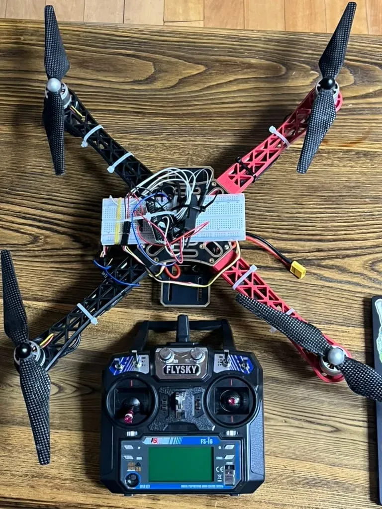
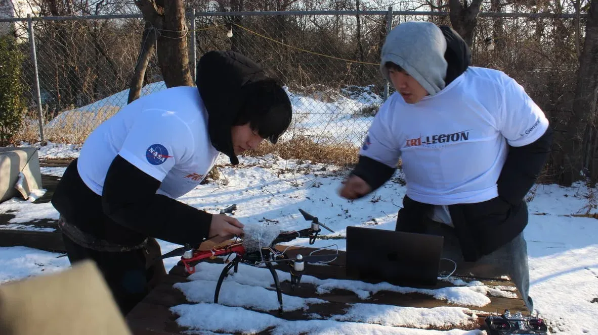
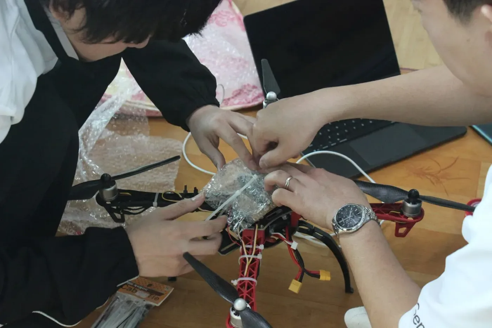

<div align="center">

# 🛸 TLAL Drone

**TLAL 팀의 첫 드론 — 동체 제작부터 ESP32 비행제어장치(FC) 펌웨어, 비행시험까지**





</div>

## 소개

[TLAL(Tri-Legion Aerodynamics Lab)](https://github.com/jiwonsudo/TLAL-Homepage) 팀의 첫 드론 프로젝트입니다. 동체를 직접 조립하고, ESP32 기반 비행제어장치(FC) 펌웨어를 C++로 작성해 실제 비행시험까지 진행했습니다.

- **MPU6050** 자이로·가속도 센서로 자세 추정
- **QMC5883L** 지자기 센서와 **GPS**로 방위·위치 확인
- **iBus** 프로토콜로 조종기 입력 수신
- **200Hz PID 제어 루프**로 네 모터의 PWM을 실시간 제어
- 배터리 전압 모니터링

<p align="center"></p>

## 회로도

<p align="center"></p>

부품 사양은 [`drone build specification/specification.xlsx`](drone%20build%20specification/specification.xlsx)에 정리되어 있습니다.

## 구조

센서·모터·배터리·GPS를 각각 매니저 클래스로 나눠 유지보수하기 쉽게 만들었습니다.

```
src/
├─ Main.cpp               setup · 메인 제어 루프 (PID)
├─ MPU6050_Manager.h      자이로·가속도 → 자세
├─ QMC5883L_Manager.h     지자기 → 방위
├─ GPS_Manager.h          GPS 파싱 (TinyGPSPlus)
├─ Motor_Manager.h        ESC PWM 출력 (ESP32Servo)
└─ Battery_Manager.h      배터리 전압 측정
```

## 빌드 & 업로드

[PlatformIO](https://platformio.org/)가 필요합니다. 라이브러리는 `platformio.ini`의 `lib_deps`로 자동 설치됩니다.

```bash
pio run                  # 빌드
pio run -t upload        # ESP32에 업로드
pio device monitor       # 시리얼 모니터 (115200 baud)
```

| 라이브러리 | 용도 |
|---|---|
| mikalhart/TinyGPSPlus | GPS 데이터 파싱 |
| bmellink/IBusBM | 조종기 iBus 통신 |
| rfetick/MPU6050_light | 자이로 센서 |
| madhephaestus/ESP32Servo | 모터 PWM 제어 |
